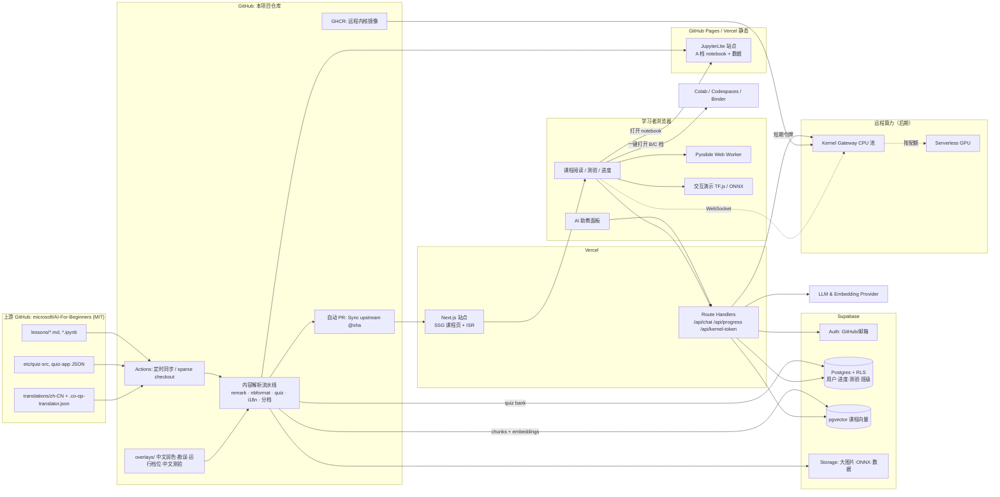

# 基于 microsoft/AI-For-Beginners 的交互式辅助教学网站：技术架构方案

> 编写日期：2026-10-21
> 分析对象：`microsoft/AI-For-Beginners` main 分支，浅克隆 commit `392d0df`（2026-09-04 23:24 UTC+8），许可证 MIT
> 本文数字都来自对克隆仓库跑脚本统计（`/workspace/AI-For-Beginners`）。少数外部事实（如 Pyodide 包列表）已标出处；还没实测的结论标为「需验证」。

---

## 0. 一页摘要

- **上游是什么**：12 周、24 课（外加 1 节 Extras），按 7 个模块组织。正文用 Markdown，动手部分用 Jupyter Notebook。大部分课程同一内容各有一份 **PyTorch 版和 TensorFlow 版**。测验是一个独立的 Vue 2 小应用，多语言版本由 Co-op Translator 机器翻译生成，共 55 个语言目录。
- **网站定位**：一个「能读、能跑、能玩、能问、能记录进度」的中文优先学习站。内容跟上游自动同步，不维护长期分叉。
- **核心取舍**：
  1. 默认展示上游**已保存的 notebook 输出**：53 个 notebook 里有 49 个带输出，零算力成本就能看到结果。
  2. **只跑 numpy/sklearn/OpenCV 的轻量 notebook 放到浏览器里运行**（Pyodide/JupyterLite）。
  3. **依赖 PyTorch/TensorFlow 的 notebook 一律交给外部或远程内核**：MVP 阶段用 Colab、Codespaces、Binder 一键打开，后期按需接入有配额限制的 GPU 内核。
  4. 自己开发 **JS 原生交互演示**（感知机、MLP、卷积核、遗传算法、CartPole、词向量、注意力等），作为教学亮点。
  5. 测验直接导入上游题库；AI 助教基于 RAG，用 Supabase pgvector 做检索，回答必须给出引用来源。
- **技术栈**：GitHub（代码 + Actions 内容流水线）＋ Next.js（部署在 Vercel）＋ Supabase（Auth/Postgres/pgvector/Storage）＋ JupyterLite 静态站（放 GitHub Pages 或 Vercel）。

---

## 1. 目标与用户

### 1.1 目标
1. 把上游课程变成结构化、可检索、中文优先的在线课程，并保持与上游同步。
2. 降低动手门槛：不用装 conda，也能在浏览器里跑通入门 notebook、操作可视化演示。
3. 提供教学闭环：课前/课后测验、学习进度、学习笔记、AI 助教答疑。
4. 服务教师：班级、作业进度看板，可按课程顺序布置任务（上游本身就有 `lessons/0-course-setup/for-teachers.md`）。

### 1.2 用户画像
| 角色 | 典型需求 | 关键功能 |
|---|---|---|
| 自学者（大学生、转行者） | 按顺序学、能跑代码、遇到问题有人答 | 课程阅读、浏览器内运行、测验、AI 助教、进度 |
| 教师/助教 | 组织班级、跟踪进度、布置测验 | 班级管理、进度看板、测验统计 |
| 进阶学习者 | 跑深度学习 notebook（需 GPU） | 一键打开 Colab/Codespaces，后期提供远程 GPU 内核 |

### 1.3 非目标（第一期）
- 不重写课程正文，也不自己维护全部 55 种语言（首期只做 zh-CN + en，其他语言保留扩展能力）。
- 不在自有服务器上为所有用户免费提供 GPU 训练。

---

## 2. 上游仓库梳理（实测）

### 2.1 目录与规模
| 项 | 数值 | 说明 |
|---|---|---|
| 仓库工作区体积 | 2.3 GB | 其中 `translations/` 1.4 GB，`translated_images/` 422 MB，`lessons/` 只有 56 MB |
| 课程模块 | 7 个 + Extras | `1-Intro`、`2-Symbolic`、`3-NeuralNetworks`、`4-ComputerVision`、`5-NLP`、`6-Other`、`7-Ethics`、`X-Extras`，另有 `0-course-setup` |
| 课程编号 | 24 课 + 1 节 Extras（X1 多模态/CLIP） | 以 README 课程表为准 |
| `lessons/` 下 Markdown | 56 个 | 其中 README.md 42 个（实验 lab README 12 个） |
| `lessons/` 下 Notebook | **53 个** | 实验 notebook 8 个；另有根目录 `Untitled.ipynb`（2 个 cell，可忽略）、`examples/03-image-classifier.ipynb` |
| Notebook 单元格 | 共 1466 个，其中代码单元 769 个 | |
| 带已保存输出的 Notebook | **49 / 53** | 可以直接静态渲染输出 |
| 框架分布（按 import 统计，53 个） | TensorFlow/Keras 21、PyTorch 14、两者都不用 18 | 「两者都不用」= 纯 numpy/sklearn/OpenCV/符号 AI 等 |
| 同时有 PyTorch 和 TF 双版本的课 | 13 课 | 第 5、7、8、9、10、12、13–18、22 课 |
| 无 notebook 的课 | 第 1（引言）、23（多智能体）、24（伦理）课，以及 0-setup | 纯阅读课 |
| 课内辅助 .py | 8 个 | `pytorchcv.py`/`tfcv.py`（第 7、8 课各一份）、`torchnlp.py`（第 14、16、17、18 课）。notebook 运行时必须一起挂载 |
| 课内图片 | png 100、jpg 17、jpeg 2、gif 6、svg 1 | sketchnotes 13 MB |
| 文本量（粗略按空格分词） | Markdown ≈ 3.9 万词；notebook 源 ≈ 6.9 万词 | RAG 语料规模很小，单语种切块后预计只有几千块 |
| 测验 | 英文 24 个 lesson JSON，**48 套（每课课前+课后）、145 题**（23×6 + 7） | 西语只有第 1 课。课程 Markdown 中链接了 46 个不同的测验 URL（`ff-quizzes.netlify.app/en/ai/quiz/1..46`） |
| 测验源格式 | `etc/quiz-src/questions-en.txt`（`*` 题干、`+` 正确、`-` 错误）→ `qzmkjson.py` 转成 JSON | 解析非常简单，可以直接复用 |
| 翻译 | `translations/` 下 55 个语言目录（含 `en`）。以 zh-CN 为例：67 个 md + 54 个 ipynb，Markdown 末尾带机器翻译免责声明 | `.co-op-translator.json` 用 `original_hash`（源文件 MD5）记录对应的源版本 |
| zh-CN 翻译新鲜度 | 69 条带 hash 的记录中，**64 条与当前英文源 MD5 一致，5 条已过期**（README、how-to-run、3-NeuralNetworks/README、TrainingTricks、5-NLP/README） | 流水线可据此给页面标注「译文可能滞后」 |
| 上游活跃度 | 2026-07-01 之后 main 上的 commit ≥ 100（API 单页上限就是 100）；含 dependabot、notebook 修订 | 需要持续同步，不适合一次性导入 |
| 现有站点 | 根目录 `index.html`，基于 docsify | 我们不复用它，只作参考 |

### 2.2 依赖与环境（上游）
- `environment.yml`：python、numpy 1.26、matplotlib 3.9、scipy 1.13、scikit-learn、opencv、ipywidgets、pytorch/torchvision/torchtext/torchdata（pytorch channel）。
- `requirements.txt`：tensorflow 2.17.0、keras 3.15.0、tensorflow-datasets 4.9.6、tensorflow-hub 0.16.1、gensim 4.3.3、gym 0.26.2、pygame 2.6.0、nltk、tokenizers、torchinfo、scikit-image、seaborn 等。
- `lessons/5-NLP/requirements-pytorch.txt`、`requirements-tf.txt` 另有 NLP 专用依赖。
- `.devcontainer`（miniconda，2 CPU）和 `binder/` 配置都已存在，可以直接用于「在 Codespaces/Binder 打开」。
- 部分 notebook 还 import 了 requirements 里没有的包：`experta`、`rdflib`、`owlrl`、`gedcom`、`textblob`、`pytorch_lightning`、`transformers`、`clip`、`tensorflow_text`、`official`（tf-models）等。远程内核镜像必须补齐这些包。

### 2.3 Notebook 运行分级（决定交互方案的关键）
按 import、数据下载、训练轮数（`epochs=`）和预训练模型分成三档：

**A 档：浏览器可跑（Pyodide）**。依赖限于 numpy/matplotlib/sklearn/pandas/OpenCV/纯 Python 包：
| Notebook | 依赖要点 | 备注 |
|---|---|---|
| 03-Perceptron/Perceptron | numpy、sklearn、ipywidgets、MNIST pkl（仓库内 `data/mnist.pkl.gz`） | ipywidgets 需 JupyterLite 扩展，需验证 |
| 03-Perceptron/lab/PerceptronMultiClass | numpy、MNIST pkl | |
| 04-OwnFramework/OwnFramework、lab/MyFW_MNIST | numpy、sklearn | 「自己写框架」，最适合浏览器运行 |
| 05-Frameworks/lab/LabFrameworks | pandas、seaborn、sklearn | seaborn 通过 micropip 安装 |
| 06-IntroCV/OpenCV | cv2、numpy | Pyodide 内置 opencv-python；视频读取需验证 |
| 21-GeneticAlgorithms/Genetic | numpy、matplotlib | |
| 2-Symbolic/Animals | experta（纯 Python） | micropip 安装，需验证 |
| 2-Symbolic/FamilyOntology | rdflib、owlrl、gedcom（纯 Python） | micropip 安装，需验证 |
| 2-Symbolic/MSConceptGraph | 请求 conceptnet API、newsapi（需要 key） | 浏览器端有 CORS 和 key 问题，需要服务端代理或改为只读 |
| 实验占位：MovementDetection、BodySegmentation、MountainCar；Diophantine（无代码） | — | 只渲染即可 |

**B 档：CPU 可跑但慢或依赖重**（PyTorch/TF + MNIST/CIFAR-10/AG_NEWS，epochs 3–30）。浏览器里跑不了（Pyodide 没有 torch/tensorflow），需要远程 CPU 内核：
IntroKeras、IntroKerasTF（epochs 10/15）、IntroPyTorch（10/30，用 pytorch_lightning）、Dropout、ConvNets PyTorch/TF（CIFAR-10，5 epochs）、TextRepresentation ×2、CBoW ×2（TF 版 200 epochs）、RNN ×2、Generative ×2、NER-TF（需 Kaggle `ner_dataset.csv`，要手动下载）、CartPole-RL ×2、22-DeepRL/notebook、GPT-PyTorch（`openai-gpt` 推理）、TransformersTF（small BERT）。
其中 Embeddings ×2 要通过 gensim 下载 `word2vec-google-news-300`（gensim-data 标称约 1.6 GB），内存和下载开销都很大，建议归入 C 档，或换成小词表。

**C 档：需要 GPU 和/或大数据集**：
TransferLearning PyTorch/TF（Microsoft Cats&Dogs 压缩包，VGG16/ResNet）、AdversarialCat_TF（迭代 100–1000 次）、AutoEncoders ×2（25–30 epochs）、GAN ×2（PyTorch 版 100 epochs）、StyleTransfer ×2（VGG16）、ObjectDetection（VGG16，30 epochs）、SemanticSegmentation ×2（PH2 数据集 Dropbox rar，30/100 epochs）、实验 PetFaces/OxfordPets（Oxford-IIIT Pets 图片包）、TransformersPyTorch（`bert-base-uncased` 微调）、X1 Clip（ViT-B/32）。全部 53 个 notebook 中有 11 个的代码显式包含 cuda/gpu 判断（不全在 C 档）。

> 结论：大约 **9 个 notebook（A 档）可以做到真正「浏览器内运行」**，约占 53 个中的 1/6。其余靠「已保存输出 + 外部/远程内核 + JS 交互演示」覆盖教学体验。各档数量是按 import 静态分析得出的，上线前需要逐个实测。

### 2.4 Pyodide 包可用性（来源：pyodide.org「Packages built in Pyodide」页面，2026-10-21 抓取）
内置：numpy、scipy、pandas、matplotlib、scikit-learn、scikit-image、opencv-python、Pillow、nltk、networkx、tqdm。
未内置：torch、tensorflow、transformers、tokenizers、gensim、gym/gymnasium、rdflib、seaborn、textblob。其中纯 Python 包（rdflib、seaborn、experta 等）可以用 micropip 安装；C 扩展包（gensim 等）不可用。

---

## 3. 内容解析与导入流水线

### 3.1 总体思路
「上游仓库 → GitHub Actions 定时同步 → 解析成结构化内容包 → 构建静态页面，同时写入 Supabase（检索索引、测验题库）」。上游作为 **git submodule 或 sparse checkout** 引入，排除 `translations/`、`translated_images/` 中我们用不到的语言，避免 2.3 GB 全量拉取。上游 README 已经给出 sparse-checkout 的做法。

```
sync job (cron 每日 + 手动触发)
 ├─ git sparse-checkout: lessons/ etc/quiz-src/ etc/quiz-app/src/assets/translations/ data/ examples/
 │                       translations/zh-CN/ (+ 对应 translated_images 中 *.zh-CN.* 图片，需按文件名过滤，需验证)
 ├─ 对比上次的 upstream commit，只处理有变化的文件
 ├─ parse/
 │   ├─ curriculum.ts   ← 解析根 README 课程表 → lessons manifest（编号、模块、标题、notebook 列表、lab、MS Learn 链接）
 │   ├─ markdown        ← remark/rehype：改写相对链接与图片路径、提取 quiz 链接、标题锚点、数学公式
 │   ├─ notebook        ← nbformat 解析：cells → 结构化 JSON（markdown / code / outputs）
 │   ├─ quiz            ← 复用 questions-en.txt 语法 / 直接读 lesson-N.json
 │   └─ i18n            ← 读取 .co-op-translator.json，按 MD5 判断译文是否过期
 ├─ classify           ← 给 notebook 打运行档位 A/B/C（规则 + 人工覆盖文件 runtime-overrides.yaml）
 ├─ emit/
 │   ├─ content/*.json + 资源图片 → Next.js 构建
 │   ├─ jupyterlite/   → 只放 A 档 notebook + 辅助数据（mnist.pkl.gz 等）
 │   └─ embeddings     → 切块、向量化、upsert 到 Supabase pgvector
 └─ PR bot：自动开 PR「Sync upstream @<sha>」，附变更摘要；CI 通过后合并即部署
```

### 3.2 Markdown 处理要点
- 课程 README 结构基本统一：`## [Pre-lecture quiz](…/quiz/N)`、正文、`## [Post-lecture quiz]`、`## [Assignment](lab/README.md)`。按这些标题把 quiz 链接替换成站内测验组件，把 Assignment 链接替换成实验卡片。
- 相对图片（`images/xxx.png`）改写为构建产物 URL，图片经 `sharp` 压缩并转成 webp。
- 有内嵌 HTML（``、表格），需要用 `rehype-raw` 并配合 sanitize 白名单。
- 有注释掉的外链公式图片（sciweavers），忽略即可；公式用 KaTeX 渲染。
- `✅` 开头的引用块是上游的「思考题」，可以转成可折叠的交互提示卡。

### 3.3 Notebook 处理要点
- 解析成 cell 序列。输出类型（`image/png`、`text/html`、`stream`、`application/vnd.jupyter.widget-view+json`）分别渲染。没有 kernel 时 widget 输出降级为静态图。
- **大输出体积**：OpenCV.ipynb 约 2.1 MB、OxfordPets 约 6 MB、StyleTransfer 约 4.8 MB（base64 图片为主）。构建时把内嵌图片抽成独立文件并懒加载。
- 同一课的 PyTorch/TF 两个版本做成**标签页切换**，记住用户偏好的框架。
- 每个代码 cell 带操作按钮：「复制」「在浏览器运行」（仅 A 档）「在 Colab 打开」「在 Codespaces 打开」。Colab 链接格式为 `https://colab.research.google.com/github/<org>/<repo>/blob/<sha>/<path>`，固定到同步时的 commit。
- 辅助 .py（pytorchcv/tfcv/torchnlp）在打开远程或浏览器内核时一起挂载。

### 3.4 与上游同步策略
- **只读镜像 + 覆盖层（overlay）**：上游内容一律不在本仓库直接修改。中文润色、补充讲解、勘误、运行档位覆盖写在 `overlays/<lesson>/…` 里，构建时合并，避免冲突。
- **译文策略**：优先使用上游 zh-CN 机翻，原 MD5 不一致时在页面顶部提示「英文原文已更新」并提供英文对照。重点课程的人工校对结果放进 overlay。
- **变更检测**：按文件 MD5 和 cell 级 diff 判断，只重建受影响页面和向量块。
- **失效链接巡检**：CI 定期检查外部数据集 URL（Oxford、Dropbox、download.microsoft.com 等），失效时告警。

---

## 4. 核心交互功能

### 4.1 代码运行：浏览器内 vs 远程内核
| 维度 | 浏览器内（Pyodide / JupyterLite） | 远程内核（Jupyter Server / Enterprise Gateway / 第三方） |
|---|---|---|
| 覆盖范围 | A 档约 9 个 notebook；纯 numpy 片段 | 全部 53 个（B/C 档需 CPU/GPU） |
| 成本 | 接近零（静态托管） | CPU 每会话就有成本；GPU 很贵 |
| 启动 | 首次加载 Pyodide 加上 numpy/sklearn 等包需要下载数十 MB，之后靠缓存 | 冷启动镜像（含 torch + tf）数 GB，需要预热池 |
| 安全 | 浏览器沙箱，无服务端风险 | 需要隔离（gVisor/Firecracker）、出网控制、资源配额、防挖矿 |
| 体验限制 | 不支持 torch/tf；大文件、视频读取受限；无真正多线程 | 网络延迟；排队 |

**推荐分层方案**：
1. **L0 静态输出**（全部 notebook）：展示上游保存的输出，49/53 都有。
2. **L1 浏览器内运行**（A 档）：
   - **Cell 级嵌入**：在课程页面内嵌可编辑代码块，Pyodide 跑在 Web Worker 里，matplotlib 输出转成图片。用于「改参数再运行」式的小练习。
   - **整本 JupyterLite**：构建 `jupyterlite-pyodide-kernel` 静态站，预置 A 档 notebook 和数据，课程页面一键打开。ipywidgets 需验证。
3. **L2 一键外部环境**（B/C 档，MVP 就提供）：Colab、GitHub Codespaces（仓库自带 devcontainer）、Binder（自带 `binder/`）。零成本，适合 GPU 课程（Colab 有免费 GPU 额度）。
4. **L3 自建远程内核**（完整版，可选）：
   - CPU 池：Docker 镜像基于上游 environment.yml，补齐 2.2 节缺失的包。部署在 Fly.io/Railway/K8s，使用 Jupyter Kernel Gateway。前端通过 `@jupyterlab/services` 或 thebe 连接。
   - GPU：按需调用 Modal/RunPod 等 serverless GPU，**只对登录用户开放并按配额计费**（如每人每周 N GPU 分钟），预先缓存数据集和模型权重（Cats&Dogs、VGG16、bert-base 等）。
   - Vercel 只负责签发短期内核令牌，不承担内核本身（Vercel 函数不适合长连接和重计算）。

### 4.2 可视化交互演示（Playground）
用 React + Canvas/SVG（必要时加 TensorFlow.js / ONNX Runtime Web / transformers.js）实现，**不依赖 Python**，每课都可以嵌入：
| 课 | 演示 | 实现要点 |
|---|---|---|
| 3 感知机 | 二维点点击打标，逐步看权重和决策边界更新；学习率、迭代步进 | 纯 TS，几十行核心算法 |
| 4 自己的框架 | 计算图前向/反向可视化，展示链式法则梯度流（上游近期正好修订了 OwnFramework 反向传播的说明） | D3 |
| 5 框架 / MLP | 类 TensorFlow Playground：层数、激活函数、正则，实时训练 2D 分类 | TF Playground 是 Apache-2.0，可借鉴或改写，需保留声明 |
| 6–7 CV/卷积 | 卷积核编辑器：上传图片，应用 3×3 核，看特征图；MNIST 手写板加小 CNN 实时推理 | TF.js 或 ONNX，模型离线训练好以后导出 |
| 8 迁移学习 | MobileNet 浏览器推理，展示 top-5 结果 | TF.js 预训练模型 |
| 9–10 自编码器/GAN | 潜空间滑杆生成 MNIST 数字 | 离线训练小模型并导出 ONNX |
| 13–15 文本表示/嵌入 | BoW/TF-IDF 计算器；词向量 2D 投影探索器（小词表 GloVe 子集） | 预计算 JSON |
| 16–17 RNN | 字符级生成，温度滑杆 | 小模型 ONNX |
| 18 Transformer | 注意力热力图（句子输入 → 各 head 注意力） | transformers.js 小 BERT，需验证体积 |
| 21 遗传算法 | 种群进化动画（可直接复刻 notebook 里的问题） | 纯 TS |
| 22 强化学习 | 浏览器版 CartPole，看策略学习曲线 | 纯 TS 物理模拟 + 简单策略梯度 |
| 2 符号 AI | 专家系统规则推理演示（动物识别），一步步推导 | 纯 TS |

### 4.3 测验
- 导入上游 48 套 145 题（英文），保留 `id` 映射（上游 `mk_id`：课号 +100 为课前、+200 为课后），同时兼容 Markdown 中 `quiz/1..46` 的链接序号，导入时建立对照表并人工核对。
- 中文题目：上游没有中文题库，用 LLM 翻译加人工审核，存进 overlay（`overlays/quiz/zh-CN/*.json`）。
- 题型先支持单选/判断，和上游一致；之后扩展多选、填空、代码题（Pyodide 里跑断言来判分）。
- 记录作答，计算正确率，错题本可以联动 AI 助教讲解。

### 4.4 学习进度
- 进度粒度：课 → 小节（Markdown 标题）→ notebook → 测验。
- 未登录：localStorage；登录后合并到 Supabase。
- 「12 周学习计划」视图：沿用上游 12 周 / 24 课的节奏，可设提醒。
- 教师端：班级邀请码；进度和测验热力图；Supabase RLS 保证只能看本班数据。

### 4.5 AI 助教（RAG）
- **语料**：课程 Markdown、notebook 的 markdown 和 code cell（保留 cell 序号）、测验解析、overlay 补充讲解；中英双语都入库。
- **切块**：按标题、cell 边界切，块约 500–800 token，元数据带 `lesson_id / path / heading / cell_index / lang / upstream_sha`。语料总量很小（见 2.1），全量嵌入成本很低。
- **检索**：Supabase pgvector（HNSW）+ Postgres 全文检索做混合召回，可选 rerank。**优先当前课程**（按 lesson_id 加权）。
- **生成**：Vercel AI SDK 流式输出。模型通过可配置的 provider 抽象接入，便于切换和控制成本。系统提示要求「基于引用回答、给出课程链接、不确定就说不确定、鼓励思考而不是直接给作业答案」。
- **上下文感知**：把当前页、选中的代码、最近一次报错（浏览器内核的 traceback）一起作为上下文。
- **防滥用**：登录后才能使用；Upstash/Supabase 计数限流；记录日志和反馈（👍/👎）用于评估。
- **评估**：基于测验题和人工问题集构造回归评测，同步上游后自动跑一遍。

---

## 5. 技术选型与理由

| 层 | 选型 | 理由 |
|---|---|---|
| 代码托管/CI | **GitHub** + GitHub Actions | 符合用户偏好；上游也在 GitHub，submodule、sparse checkout、定时同步、PR bot 都很顺手 |
| 前端框架 | **Next.js（App Router）+ TypeScript + Tailwind + shadcn/ui** | 静态生成（SSG/ISR）课程页，同时有服务端路由支持 Auth/RAG API；和 Vercel 集成最好 |
| 内容渲染 | unified（remark/rehype）、KaTeX、Shiki 代码高亮；自研 Notebook 渲染组件（参考 nbviewer 的输出 MIME 处理） | 可控、可做交互替换 |
| 浏览器内 Python | Pyodide（Web Worker）+ JupyterLite（pyodide kernel） | 零服务器成本；sklearn/OpenCV 内置 |
| 交互演示 | React + Canvas/D3；TF.js / ONNX Runtime Web / transformers.js | 不依赖 Python，移动端也能运行 |
| 后端 | Next.js Route Handlers / Server Actions（Vercel Functions）；重任务放 Supabase Edge Functions 或 GitHub Actions | 第一期没有独立后端服务，运维最轻 |
| 数据库/认证 | **Supabase**：Postgres + Auth（GitHub OAuth 登录正好契合开发者用户）+ RLS + pgvector + Storage | 一站式；RLS 天然支持教师/班级权限 |
| 静态资源 | 课程图片随构建产物走 Vercel CDN；大文件（notebook 抽出的图片、ONNX 模型、JupyterLite 数据）放 Supabase Storage 或 GitHub Releases | 控制构建体积 |
| JupyterLite 托管 | GitHub Pages（独立 repo 或 `gh-pages` 分支），或 Vercel 子路径 | 纯静态；需要配置 COOP/COEP 时 Vercel 的 headers 更好控制 |
| 远程内核（后期） | Docker 镜像（GHCR 托管）+ Kernel Gateway（Fly.io / K8s）；GPU 用 serverless（Modal 等） | Vercel 不适合长连接和重计算 |
| 观测 | Vercel Analytics、Sentry、Supabase 日志；LLM 调用记录到自建表 | |
| 备选（纯静态路线） | Astro/Docusaurus + GitHub Pages，测验进度只存本地 | 最省钱，但没有账号、班级和 RAG 服务端；可作为 MVP 前的「Phase 0」 |

---

## 6. 系统架构图



---

## 7. 数据模型（Supabase / Postgres）

```sql
-- 内容（由流水线写入，前端只读）
create table upstream_sync (
  id bigserial primary key,
  upstream_sha text not null,
  synced_at timestamptz default now(),
  changed_files jsonb
);

create table modules (
  id text primary key,            -- '3-NeuralNetworks'
  order_no int, title_en text, title_zh text
);

create table lessons (
  id text primary key,            -- '03-Perceptron'（与目录名一致）
  module_id text references modules(id),
  lesson_no int,                  -- 1..24, X1 用 25
  title_en text, title_zh text,
  path text,                      -- 'lessons/3-NeuralNetworks/03-Perceptron'
  has_lab boolean,
  upstream_sha text,
  zh_stale boolean default false  -- 依据 .co-op-translator.json MD5
);

create table notebooks (
  id text primary key,            -- path 的 slug
  lesson_id text references lessons(id),
  path text, framework text check (framework in ('pytorch','tensorflow','none')),
  is_lab boolean,
  runtime_tier char(1) check (runtime_tier in ('A','B','C')),
  needs_gpu boolean, datasets jsonb, extra_deps text[],
  has_outputs boolean
);

create table quizzes (
  id int primary key,             -- 上游 mk_id：101.. 课前 / 201.. 课后
  lesson_id text references lessons(id),
  kind text check (kind in ('pre','post')),
  legacy_url_no int               -- ff-quizzes /quiz/N 对照
);
create table quiz_questions (
  id bigserial primary key,
  quiz_id int references quizzes(id),
  order_no int, lang text,        -- 'en' | 'zh-CN'
  question text, options jsonb,   -- [{text, is_correct}]
  explanation text
);

-- RAG
create extension if not exists vector;
create table doc_chunks (
  id bigserial primary key,
  lesson_id text references lessons(id),
  source_path text, heading text, cell_index int,
  lang text, content text,
  embedding vector(1536),         -- 维度随所选 embedding 模型调整
  tsv tsvector generated always as (to_tsvector('simple', content)) stored,
  upstream_sha text
);
create index on doc_chunks using hnsw (embedding vector_cosine_ops);
create index on doc_chunks using gin (tsv);

-- 用户与学习数据（RLS: user_id = auth.uid()）
create table profiles (
  id uuid primary key references auth.users,
  display_name text, role text default 'learner', -- learner|teacher|admin
  preferred_framework text, locale text default 'zh-CN'
);
create table progress (
  user_id uuid references auth.users, lesson_id text references lessons(id),
  item_type text, item_id text,   -- section|notebook|quiz|playground
  status text, updated_at timestamptz default now(),
  primary key (user_id, lesson_id, item_type, item_id)
);
create table quiz_attempts (
  id bigserial primary key, user_id uuid references auth.users,
  quiz_id int references quizzes(id), answers jsonb, score numeric,
  created_at timestamptz default now()
);
create table classes (
  id uuid primary key default gen_random_uuid(),
  teacher_id uuid references auth.users, name text, invite_code text unique
);
create table class_members (
  class_id uuid references classes(id), user_id uuid references auth.users,
  primary key (class_id, user_id)
);

-- AI 助教
create table chat_sessions (id uuid primary key default gen_random_uuid(),
  user_id uuid references auth.users, lesson_id text, created_at timestamptz default now());
create table chat_messages (id bigserial primary key, session_id uuid references chat_sessions(id),
  role text, content text, citations jsonb, tokens int, feedback smallint,
  created_at timestamptz default now());

-- 远程内核配额（后期）
create table kernel_usage (id bigserial primary key, user_id uuid references auth.users,
  notebook_id text, tier text, seconds int, gpu boolean, created_at timestamptz default now());
```

内容类数据（lessons/notebooks/quiz）同时以 JSON 形式随构建产物发布，页面渲染不依赖数据库。数据库主要存用户数据和检索索引。

---

## 8. 分阶段里程碑与工作量估计

按 1 名全栈 + 0.5 名内容/教研估算，单位为人周。是粗估，±30%。

| 阶段 | 范围 | 交付物 | 估计 |
|---|---|---|---|
| **Phase 0：技术验证（1–2 周）** | sparse 同步脚本；Markdown 和 notebook 渲染原型；在 Pyodide 中实测 A 档 9 个 notebook | 可行性报告、A 档最终名单 | 1.5 |
| **Phase 1：MVP（约 6–8 周）** | ① 同步流水线 + 自动 PR；② 25 节课程页（中英切换、zh-CN 过期提示、PyTorch/TF 标签页、静态输出）；③ 全部 notebook 提供 Colab/Codespaces/Binder 按钮；④ A 档 notebook 支持 JupyterLite 运行和 cell 级运行；⑤ 测验（导入 145 题英文 + 中文翻译审核）；⑥ 本地进度 + Supabase GitHub 登录同步；⑦ 2 个旗舰演示（感知机、MLP Playground） | 部署在 Vercel 的公开站点 | 7–9 |
| **Phase 2：增强（约 6 周）** | ① AI 助教 RAG（双语向量、引用、限流、反馈）；② 再做 4–6 个演示（卷积核、遗传算法、CartPole、词向量、注意力）；③ 错题本；④ 搜索；⑤ 教师班级与看板 | v1.0 | 6–8 |
| **Phase 3：完整版（约 6–10 周）** | ① 自建 CPU 远程内核（统一镜像、隔离、配额）；② GPU 按需内核（登录 + 配额 + 预缓存数据集/权重）；③ 代码题自动判分；④ 更多语言；⑤ 学习分析 | v2.0 | 8–12 |
| 持续运营 | 上游同步审核、译文校对、数据集链接巡检、成本监控 | — | 约 0.2 人/月 |

---

## 9. 风险与对策

| 风险 | 说明 | 对策 |
|---|---|---|
| **许可证合规（MIT）** | 上游是 MIT（Copyright (c) Microsoft Corporation），允许修改和商用，但**必须保留版权声明和许可文本** | 站点页脚和「关于」页注明来源、链接上游仓库并附 MIT 全文；本仓库保留 `LICENSE-upstream`；每页标注「内容来自 microsoft/AI-For-Beginners @sha」；不使用 Microsoft 商标暗示官方背书 |
| 第三方素材 | sketchnotes（作者 Tomomi Imura）、维基百科图片、外部数据集（Oxford-IIIT Pets、Kaggle NER、PH2、Microsoft Cats&Dogs）各有自己的条款 | 原样保留署名；**不在自有存储里转存数据集**，运行时从官方地址下载，或让用户自行下载（例如 Kaggle NER）；PH2 等研究用数据集要单独核实条款再决定是否预缓存 |
| 机器翻译质量 | zh-CN 是 Co-op Translator 机翻，并有 5 个文件已过期 | 保留免责声明；按 MD5 提示过期；重点课程人工校对后放 overlay；可回馈上游 |
| **重型 notebook 运行成本** | C 档要 GPU 和数百 MB 到 GB 级数据（word2vec-google-news-300 约 1.6 GB、Cats&Dogs、VGG16/BERT 权重），免费开放会被滥用 | MVP 只提供外部环境（Colab/Codespaces/Binder）；自建内核仅限登录用户，按配额使用，空闲超时回收；镜像预置数据集和权重；监控和预算告警；必要时提供「缩小版」notebook（子集数据、更少 epochs），作为 overlay 并注明改动 |
| 远程内核安全 | 任意代码执行 | 容器隔离（gVisor/Firecracker）、只读文件系统、出网白名单、CPU/内存/时长限制、防挖矿检测 |
| 浏览器运行限制 | Pyodide 首次加载体积大；ipywidgets、视频 I/O、micropip 包兼容性没有完全验证 | Phase 0 逐个实测；Service Worker 缓存；失败时自动回退到静态输出和 Colab |
| 上游结构变动 | 上游活跃，目录或 README 课程表格式可能变化 | 解析器写单元测试和快照测试；同步走 PR 人工审核；解析失败时保留上一版 |
| 外部链接失效 | 数据集 URL（Dropbox、ox.ac.uk）、conceptnet/newsapi 服务 | CI 链接巡检；MSConceptGraph 走服务端代理或改为只读输出 |
| 测验编号不一致 | quiz-app 用 `mk_id`（101/201…），Markdown 链接用 1..46，且第 24 课有 7 题 | 导入时生成对照表并人工核对 |
| LLM 成本与幻觉 | 助教费用、答错 | 强制检索引用、低温度、限流、缓存常见问答、评测集回归；明确「AI 生成，仅供参考」 |
| 依赖漂移 | 上游 pin 了 TF 2.17 / Keras 3.15 等，torch 未 pin | 远程内核镜像按 upstream_sha 打 tag，固定可复现；dependabot 变更触发镜像重建和冒烟测试（逐个跑 notebook，可以只跑前 N 个 cell） |

---

## 10. MVP 建议（落地顺序）

1. **先做内容站，交互逐步加**：Next.js + Vercel + GitHub Actions 同步。25 节课程页中英对照，PyTorch/TF 标签页，**全部 notebook 用上游保存的输出静态渲染**。这样上线第一天就有完整课程。
2. **每个 notebook 都有「在 Colab / Codespaces / Binder 打开」**：利用上游自带的 devcontainer 和 binder 配置，零成本覆盖 B/C 档。
3. **A 档约 9 个 notebook 接入 JupyterLite 和 cell 级 Pyodide**（感知机、自己的框架、OpenCV、遗传算法、符号 AI 等）。这些正好是入门阶段最需要「动手改代码」的部分。
4. **两个旗舰演示**：感知机决策边界、MLP Playground，体现「辅助教学」差异化。
5. **测验 + 进度**：导入 145 题，中文翻译审核；Supabase GitHub 登录，同步进度。
6. **AI 助教放到 Phase 2**：等内容和数据模型稳定后再接 RAG，避免早期反复重建索引。
7. MVP 阶段**不自建任何远程内核**，按真实用量数据再决定是否投入 GPU。
